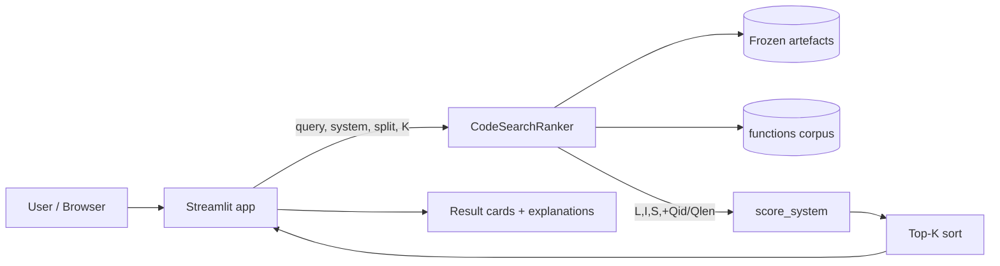
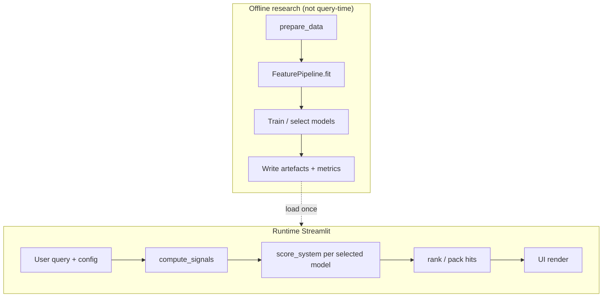
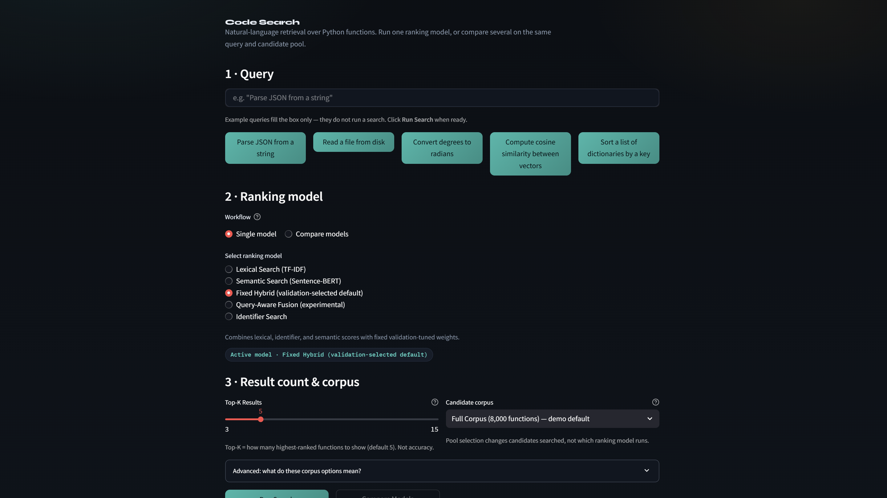
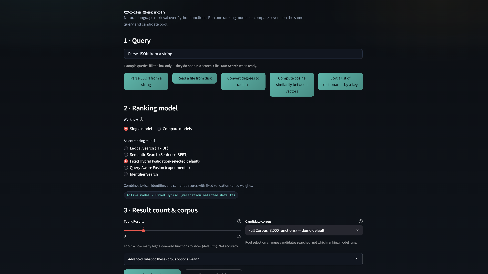
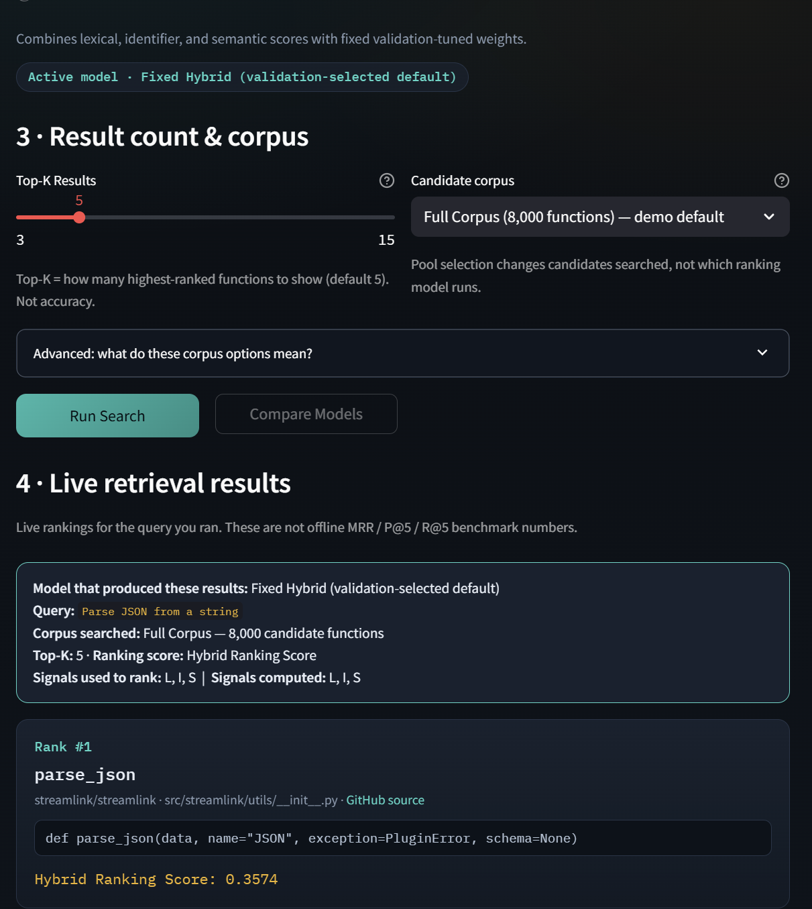
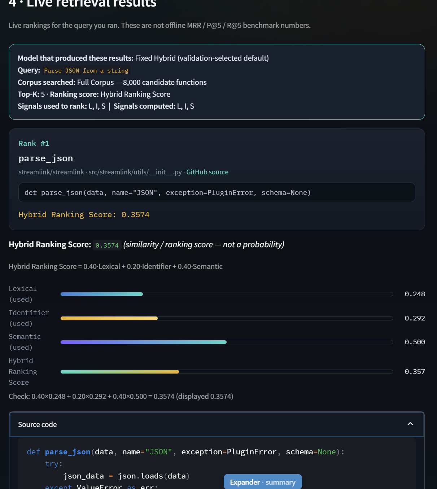
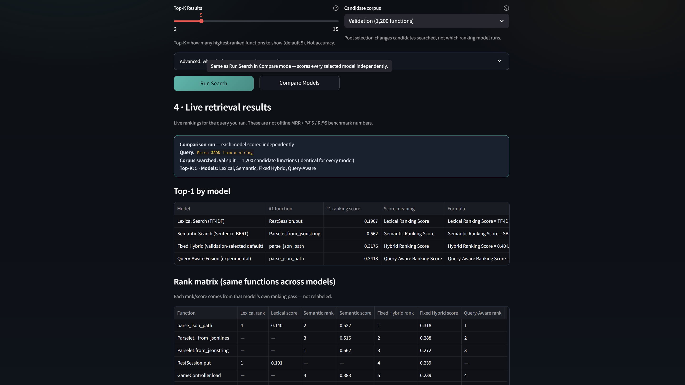

# Prototype Implementation Content for AML Report

**Project title:** Smart Code Search Using Supervised Relevance Prediction and Hybrid Text Features  
**Course:** Artificial Intelligence and Machine Learning (24CS52)  
**Institution:** Ramaiah Institute of Technology — Department of Computer Science and Engineering  
**Purpose of this document:** Report-ready application / prototype supplement for incorporation into the main AML project report (Additional Project Documentation).  
**Audience:** Arnav Chatterjee (report revision) and the project team.  
**Source of truth:** Current repository implementation (`app/`, `src/codesearch/`, `scripts/`, `artifacts/`, `results/`, `data/`).  

> **Honesty boundary.** This document describes the *implemented* Streamlit prototype and runtime ranker. It does **not** claim ANN indexing, vector-database retrieval, live GitHub search APIs, real-time model training, calibrated probabilities, or latency numbers that were not measured. Offline LR/RF models are research artefacts and are **not** Streamlit ranking options. Fixed Hybrid is the validation-selected default; Query-Aware Fusion is experimental.

---

## A. Project organisation and planning

### A.1 Process model

The team followed an **iterative research-and-prototyping workflow**, not a formal Scrum/Agile ceremony with sprints, story points or product-owner rituals (those are not evidenced in the repository).

**Why this process fits the project**

1. **Data quality first** — CodeSearchNet Python needed cleaning, sampling and repository-disjoint splits before any ranking claim was meaningful.  
2. **Baselines before novelty** — Lexical, identifier and semantic signals had to be measurable before hybrid or adaptive fusion could be judged.  
3. **Validation-driven selection** — Proposed Query-Aware Fusion was required to beat Fixed Hybrid by a pre-declared margin on validation; failing that, Fixed Hybrid remained the demo default.  
4. **Frozen artefacts → demo** — Offline training produces artefacts; the Streamlit app only loads and scores. This separation prevents demo UX from accidentally “training” or leaking test procedures.  
5. **Independent scoring tests** — Before faculty demo, `scripts/test_ranker_independence.py` verifies that changing the model changes rankings (not labels).

**Stages (actual)**

Data preparation & audit → feature / signal implementation → baseline ranking → Fixed Hybrid + Query-Aware Fusion → full-split evaluation & selection → Streamlit integration → independence / usability checks → report & demonstration.

### A.2 Development milestones

| Milestone | Primary outputs | Status |
|-----------|-----------------|--------|
| M1 Corpus freeze | 8,000 functions / 1,147 repos; repo-disjoint splits; `data/` | Completed |
| M2 Signal stack | TF-IDF lexical `L`, identifier `I`, SBERT `S`; feature pipeline artefacts | Completed |
| M3 Baselines + Fixed Hybrid | Single-signal rankers; hybrid weights `0.4L+0.2I+0.4S` | Completed |
| M4 Query-Aware Fusion | Softmax fusion over `[1,Qid,Qlen]`; offline training artefact | Completed |
| M5 Full-split evaluation | `results/primary_fullsplit_metrics.csv`; validation selection | Completed |
| M6 Streamlit prototype | `app/streamlit_app.py` + `CodeSearchRanker` | Completed |
| M7 Independence / demo hardening | Shared-pool compare; model-specific scores; stale-result hide | Completed |
| M8 Report / presentation materials | Final report + PPT (maintained separately under Resource Material) | Completed (coursework) |

### A.3 Team responsibilities

Verified from the final report contribution record:

| Member | USN | Role |
|--------|-----|------|
| Abhishek Reddy T | 1MS24CS008 | Research and ML lead — query-aware design, experimental protocol, training integration, primary analysis |
| Usman Sayed | 1MS25CS413 | Prototype and validation — baselines, metrics, Streamlit demonstrator |
| Arnav Chatterjee | 1MS24CS038 | Data and corpus lead — acquisition, cleaning, splits, pairs, data-quality documentation; currently revising the main report |

Guide / coordinator: **Uzma Sulthana**, Assistant Professor.

### A.4 Resources

**Verified**

| Resource | Detail |
|----------|--------|
| Language | Python 3 (environment used for this write-up: Anaconda / Windows) |
| Key libraries | `streamlit`, `sentence-transformers`, `scikit-learn`, `pandas`, `numpy`, `pyarrow`, `joblib`, `duckdb`, `tqdm` (see `requirements.txt`) |
| Embedding model | `sentence-transformers/all-MiniLM-L6-v2` |
| Data | CodeSearchNet Python subset frozen under `data/` |
| Artefacts | `artifacts/feature_pipeline.joblib`, embeddings, `artifacts/models/*` |
| Metrics | `results/primary_fullsplit_metrics.csv` |

**Assumptions / not independently inventoried here**

Exact laptop CPU/GPU model, RAM and disk capacity of every teammate machine; wall-clock pipeline training hours on the original training runs.

### A.5 Risks and mitigation

| Risk | Mitigation (implemented) |
|------|---------------------------|
| Silver docstring labels / noise | Disclosed as silver labels; not treated as human gold |
| Train/test leakage | Repository-disjoint splits; zero repo overlap by construction |
| Overstating Query-Aware Fusion | Validation-only selection; Fusion labeled experimental in UI |
| Silent model fallback | Ranker raises if system unavailable; no silent swap |
| Stale UI results after control change | Results hidden until explicit Run Search |
| Missing artefacts | `CodeSearchRanker` raises `FileNotFoundError` with pipeline hint |
| Reproducibility | Seeds, frozen artefacts, committed metrics CSV |
| Runtime latency on 8k pool | Exhaustive scoring accepted for demo scale; no fabricated speed claim |
| Confusing live scores with MRR | UI separates live retrieval from offline benchmark panel |

---

## B. Software requirements specification

### B.1 Product overview

**Code Search** is a **local Streamlit web application** that ranks Python functions for a natural-language programming query. The user chooses a ranking model (or compares several), selects a candidate corpus (full corpus or a train/val/test split), sets Top-K, and runs search. The system returns ranked function cards with model-specific ranking scores, optional signal breakdowns, source code, and GitHub permalinks when URLs exist in the dataset.

**Boundaries**

- Operates on the **frozen local corpus** (8,000 functions), not the live internet.  
- Does **not** crawl GitHub at query time.  
- Does **not** train models online.  
- Ranking scores are **similarities used for ordering**, not calibrated probabilities.  
- Exhaustive scoring of the selected pool (no ANN / vector DB).

### B.2 Intended users

| User | Use case |
|------|----------|
| Course faculty / examiners | Demo NL → code retrieval; compare lexical vs semantic vs hybrid vs fusion |
| Project students | Inspect rankings, scores and offline benchmarks during development |
| Internal researchers (team) | Sanity-check splits and model independence on Full / Val / Test pools |

### B.3 Operating environment

- OS: Windows 10/11 (development verified on Windows).  
- Runtime: local Python environment with `requirements.txt`.  
- UI: modern desktop browser against `http://localhost:8501`.  
- Launch: `python -m streamlit run app/streamlit_app.py`.

### B.4 Functional requirements

| ID | Requirement | Acceptance criteria |
|----|-------------|---------------------|
| FR-01 | Accept a natural-language query | Non-empty query enables Run Search; empty query cannot execute ranking (`ValueError` / disabled button) |
| FR-02 | Provide example queries | Example chips fill the query box only; they do not auto-run search |
| FR-03 | Single-model selection | User can select Lexical, Semantic, Fixed Hybrid (default), Query-Aware Fusion, or Identifier |
| FR-04 | Compare-models workflow | User can multi-select ≥2 models and run Compare Models |
| FR-05 | Candidate corpus selection | Full / Train / Val / Test pools selectable; pool size reflected in results metadata |
| FR-06 | Top-K control | Slider 3–15; returned rows ≤ Top-K |
| FR-07 | Explicit search execution | Ranking runs only on Run Search / Compare Models click |
| FR-08 | Ranked results display | Results show rank, function name, repo/path, signature, primary ranking score |
| FR-09 | Model-specific scoring | Primary score matches the selected system’s formula (L / I / S / hybrid / fusion) |
| FR-10 | Signal / weight explanation | Hybrid shows L/I/S bars + weighted check; Fusion shows adaptive weights when selected |
| FR-11 | Source code view | Expander shows function source (truncated if very long) |
| FR-12 | GitHub permalink | When `func_code_url` is http(s), UI shows a GitHub source link |
| FR-13 | Stale-result handling | Changing model/query/corpus hides prior results until a new Run Search |
| FR-14 | Offline benchmark panel | Displays validation/test MRR, P@5, R@5 separately from live retrieval |
| FR-15 | No silent fallback | Unavailable systems are omitted or error; Fixed Hybrid remains default when available |

### B.5 Non-functional requirements

| ID | Requirement | Notes |
|----|-------------|-------|
| NFR-01 Usability | Clear sections: Query → Model → Corpus → Run → Results | Implemented |
| NFR-02 Honesty | Labels distinguish default vs experimental; scores ≠ probabilities | Implemented |
| NFR-03 Reliability | Artefact load once via `@st.cache_resource`; missing artefacts fail loudly | Implemented |
| NFR-04 Maintainability | Ranker API separated from Streamlit UI | Implemented |
| NFR-05 Reproducibility | Frozen artefacts + committed metrics | Implemented |
| NFR-06 Privacy | Local corpus; no user query uploaded by the app design | Local-only demo |
| NFR-07 Latency | **Proposed target (not measured as a formal benchmark):** interactive response after warm-up on the 8k pool for single-query demos | Do **not** cite as a measured SLA |

### B.6 Interface requirements

**User interface:** Streamlit dark-themed page — query input, example chips, workflow radio, model radio/multiselect, Top-K slider, corpus selectbox, Run/Compare buttons, result cards, score panels, source expanders, offline metrics table.

**Software interfaces:** `CodeSearchRanker.rank` / `rank_many` / `compute_signals` / `score_system`.

**Data interfaces:** Parquet/CSV under `data/`; Joblib/JSON/NPY under `artifacts/`; metrics CSV under `results/`.

**Hardware:** Ordinary developer laptop sufficient for demo inference; GPU not required for MiniLM encode of a single query.

**Communication:** Localhost HTTP to Streamlit; optional outbound HTTPS only if the user clicks a GitHub permalink (browser navigation).

### B.7 User workflow and data flow

**User workflow**

1. Enter (or chip-fill) a natural-language programming query.  
2. Choose Single model **or** Compare models.  
3. Select ranking model(s), Top-K and candidate corpus.  
4. Click **Run Search** (or **Compare Models**).  
5. Inspect ranked cards, scores, optional source code and permalinks.  
6. Optionally review the offline benchmark panel (dataset-level, not this query).





---

## C. System design and implementation

### C.1 High-level architecture

**Offline subsystem:** data preparation → repository-disjoint splits → TF-IDF fit + code embeddings + identifier sets → Fixed Hybrid weight selection + Query-Aware Fusion training → full-split evaluation → freeze artefacts under `artifacts/` and metrics under `results/`.

**Runtime subsystem:** Streamlit UI → `CodeSearchRanker` loads artefacts once → on Run Search, compute shared signals for the candidate pool → score each selected system independently → sort by that system’s primary score → render Top-K.

**Bridge:** frozen artefacts only. Runtime does **not** refit TF-IDF on the full project or retrain fusion.

### C.2 Application workflow (exact)

1. User enters NL query (`st.session_state.query`).  
2. User selects Single / Compare and model(s).  
3. User sets Top-K and corpus split (`all` / `train` / `val` / `test`).  
4. User clicks Run Search or Compare Models.  
5. `rank_many` calls `compute_signals` once (TF-IDF cosine `L`, identifier overlap `I`, SBERT cosine `S`, plus `Qid`/`Qlen`).  
6. For each selected system, `score_system` maps signals → ranking scores.  
7. `_pack_hits` sorts descending and keeps Top-K.  
8. UI renders cards, score panels, source expanders and optional compare tables.

### C.3 Module-level design

| Module / file | Responsibility | Input | Output | Integration |
|---------------|----------------|-------|--------|-------------|
| `app/streamlit_app.py` | Faculty UI, controls, rendering, stale-result logic | User actions | HTML/Streamlit widgets | Calls `CodeSearchRanker` |
| `app/styles.css` | Visual styling | — | CSS | Injected by app |
| `src/codesearch/ranker.py` | Runtime API, signal compute, scoring dispatch, Top-K pack | Query, system(s), split, K | DataFrame(s) of hits | Loaded by Streamlit |
| `src/codesearch/features.py` | TF-IDF, identifier overlap, query cues, FeaturePipeline | Texts / id sets | `L`,`I`, artefacts | Used by ranker |
| `src/codesearch/embeddings.py` | SBERT load/encode + `code_repr` | Texts | Embedding arrays | FeaturePipeline / ranker |
| `src/codesearch/models.py` | Fixed hybrid score + joblib load helpers | `L,I,S`, weights | Scores / models | Ranker |
| `src/codesearch/query_aware_fusion.py` | Softmax query-conditioned fusion | `L,I,S,Qid,Qlen` | Adaptive scores + weights | Ranker (if artefact present) |
| `src/codesearch/text.py` | Tokenisation / identifier parsing | Raw strings | Tokens / id sets | Features |
| `src/codesearch/data.py` | Load functions table | `data/` | DataFrame | Ranker init |
| `src/codesearch/config.py` | Paths, seed, SBERT name | — | Constants | All modules |
| `scripts/test_ranker_independence.py` | Executable independence test | Fixed demo query | PASS/FAIL log | CI / manual QA |

### C.4 Low-level implementation

**Candidate pool:** `_candidate_indices(split)` returns all indices for `all`, else filters `func_id`s by `functions["split"]`.

**Signals:** one TF-IDF transform of the query against precomputed code TF-IDF rows; per-candidate identifier overlap; one SBERT encode of the query dotted with cached code embeddings; `query_features` for `Qid`/`Qlen`.

**Dispatch:** `score_system` copies `L`/`I`/`S` or applies `fixed_hybrid_score` / `QueryAwareFusion.score`. Unavailable systems raise `KeyError`.

**Compare:** `rank_many` shares one `compute_signals` call; each system scored independently.

**Rendering:** Streamlit cards + `render_score_panel` for single / hybrid / adaptive explanations; GitHub link if URL starts with `http`.

**Artefact load:** `FeatureArtifacts.load` + optional `query_aware_fusion.joblib` + `hybrid_weights.json`.

### C.5 Selected source code snippets

#### Snippet 1 — Query input and example chips  
**File:** `app/streamlit_app.py` (approx. lines 294–307)

```python
st.text_input(
    "Natural-language programming query",
    key="query",
    placeholder='e.g. "Parse JSON from a string"',
    label_visibility="collapsed",
)
# Example chips fill the box only — they do not run a search.
for i, ex in enumerate(EXAMPLES):
    if cols[i].button(ex, key=f"ex_{i}", use_container_width=True):
        st.session_state.pending_query = ex
        st.rerun()
```

**Demonstrates:** NL query capture; examples do not auto-execute search.

#### Snippet 2 — Model / compare configuration  
**File:** `app/streamlit_app.py` (approx. lines 311–344)

```python
mode = st.radio(
    "Workflow",
    ["Single model", "Compare models"],
    horizontal=True,
    key="mode",
)
# Single: radio over catalog labels (Fixed Hybrid default index)
# Compare: multiselect defaulting to DEFAULT_COMPARE systems
```

**Demonstrates:** FR-03 / FR-04 control surface.

#### Snippet 3 — Explicit Run Search gate  
**File:** `app/streamlit_app.py` (approx. lines 405–432)

```python
run_clicked = b1.button("Run Search", type="primary", disabled=not can_run)
# Execute ONLY on explicit button click — never on widget changes alone.
if (run_clicked or compare_clicked) and q and selected:
    results = ranker.rank_many(q, selected, top_k=top_k, split=split_choice)
```

**Demonstrates:** FR-07; prevents accidental re-rank on every radio click.

#### Snippet 4 — Ranker artefact load  
**File:** `src/codesearch/ranker.py` (approx. lines 110–137)

```python
arts = FeatureArtifacts.load(art_path)
self.pipe = FeaturePipeline(arts.sbert_name)
# restore tfidf, embeddings, identifier side data …
fusion_path = self.artifacts_dir / "models" / "query_aware_fusion.joblib"
if fusion_path.exists():
    self.models["query_aware_fusion"] = load_model(fusion_path)
self.hybrid_w = tuple(json.loads(hw.read_text(...))["weights"])  # else (0.4,0.2,0.4)
self.default_system = "fixed_hybrid"
```

**Demonstrates:** Offline→runtime bridge; Fixed Hybrid default.

#### Snippet 5 — Shared signal computation  
**File:** `src/codesearch/ranker.py` (approx. lines 176–189)

```python
qv = self.pipe.tfidf.transform([tokenize_for_tfidf(query)])
L = cosine_similarity(qv, self._code_tfidf[idxs]).ravel()
I = np.array([identifier_overlap_pair(query, self._id_list[i]) for i in idxs])
q_emb = self.pipe.sbert.encode([query], normalize_embeddings=True, show_progress_bar=False)
S = (q_emb @ self.pipe.code_emb[idxs].T).ravel()
Qid, Qlen = query_features([query])
```

**Demonstrates:** Exhaustive pool scoring; shared `L/I/S` for fair compare.

#### Snippet 6 — Model-specific scoring  
**File:** `src/codesearch/ranker.py` (approx. lines 247–261)

```python
if system == "tfidf":
    scores = L.copy()
elif system == "identifier":
    scores = I.copy()
elif system == "sbert":
    scores = S.copy()
elif system == "fixed_hybrid":
    scores = fixed_hybrid_score(L, I, S, self.hybrid_w)
elif system == "query_aware_fusion":
    scores = model.score(L, I, S, Qid, Qlen)
```

**Demonstrates:** Independent executable models (not label swaps).

#### Snippet 7 — Identifier overlap formula  
**File:** `src/codesearch/features.py` (approx. lines 114–123)

```python
def identifier_overlap_pair(query: str, id_set: set[str]) -> float:
    qt = set(word_tokens(query))
    inter = len(qt & id_set)
    jacc = inter / len(qt | id_set)
    cov = inter / len(qt)
    return 0.5 * (jacc + cov)
```

**Demonstrates:** Runtime identifier signal `I`.

#### Snippet 8 — Query-Aware Fusion weights  
**File:** `src/codesearch/query_aware_fusion.py` (approx. lines 39–45)

```python
def weights(self, Qid: np.ndarray, Qlen: np.ndarray) -> np.ndarray:
    X = np.column_stack([np.ones(len(Qid)), Qid, Qlen])  # [1, Qid, Qlen]
    logits = X @ self.W.T
    return _softmax(logits, axis=1)
```

**Demonstrates:** Research scoring path used when Fusion is selected.

#### Snippet 9 — GitHub permalink + source expander  
**File:** `app/streamlit_app.py` (approx. lines 148–174)

```python
link = f' · <a href="{url}" ...>GitHub source</a>' if url.startswith("http") else ""
# ... render card ...
with st.expander("Source code", expanded=expand_code):
    st.code(code[:4500] + ("\n# … truncated …" if len(code) > 4500 else ""), language="python")
```

**Demonstrates:** FR-11 / FR-12.

#### Snippet 10 — Compare shared pool  
**File:** `src/codesearch/ranker.py` (approx. lines 297–310)

```python
def rank_many(self, query, systems, top_k=5, split="all"):
    signals = self.compute_signals(query, split=split)  # once
    out = {}
    for sys in systems:
        scores, info = self.score_system(sys, signals)
        out[sys] = self._pack_hits(signals, scores, info, top_k)
    return out
```

**Demonstrates:** Fair same-query / same-pool comparison.

### C.6 Integration

Streamlit obtains a cached `CodeSearchRanker`. On button click it calls `rank_many`. The ranker reads corpus + artefacts, computes shared signals, dispatches scorers, and returns DataFrames. The UI maps rows to cards / compare tables / benchmark panel. Offline scripts never participate at query time.

### C.7 Implementation environment

| Item | Value |
|------|-------|
| Language | Python 3 |
| UI | Streamlit (`requirements.txt`: `streamlit>=1.28`) |
| ML / NLP | scikit-learn, sentence-transformers (`all-MiniLM-L6-v2`) |
| Data | pandas, pyarrow, duckdb |
| Persistence | joblib, numpy `.npy`, JSON |
| Dev tools | VS Code / Cursor; Git; local browser |

Exact pinned versions vary by local environment; install from `requirements.txt`.

---

## D. Testing and performance analysis

### D.1 Testing environment

- Project Python environment with artefacts already produced by the offline pipeline.  
- Primary automated script: `scripts/test_ranker_independence.py`.  
- Ad-hoc API checks for empty query, Top-K and pool sizes.  
- Manual UI inspection via Streamlit on `http://localhost:8501`.

### D.2 Test cases

| Test ID | Purpose | Input / configuration | Expected | Actual | Status |
|---------|---------|------------------------|----------|--------|--------|
| TC-01 | App launch | `streamlit run app/streamlit_app.py` | UI loads with query/model/corpus controls | Loaded; Local URL shown | **PASS** |
| TC-02 | Empty query blocked | `ranker.rank("")` | `ValueError: Empty query` | Raised as expected | **PASS** |
| TC-03 | Basic Fixed Hybrid search | Query `Parse JSON from a string`, system `fixed_hybrid`, Top-K 5, split `all` | Ranked rows with Hybrid score | `#1 parse_json`, score ≈ 0.3574 | **PASS** |
| TC-04 | Top-K honouring | Top-K=3, split `val` | Exactly 3 rows | 3 rows returned | **PASS** |
| TC-05 | Corpus switch | split `all` vs `val` | 8000 vs 1200 candidates | 8000 / 1200 | **PASS** |
| TC-06 | Independence + shared pool | `test_ranker_independence.py` | Distinct score vectors; identical `n_candidates`; model-specific formulas | PASS log (see D.3) | **PASS** |
| TC-07 | Lexical primary score = L | Independence assertions | `score == L` | Asserted true | **PASS** |
| TC-08 | Semantic primary score = S | Independence assertions | `score == S` | Asserted true | **PASS** |
| TC-09 | Hybrid arithmetic | Independence assertions | `0.4L+0.2I+0.4S` | Check matched displayed score | **PASS** |
| TC-10 | Fusion exposes weights | Independence path for `query_aware_fusion` | `wL,wI,wS` present | e.g. (0.284, 0.277, 0.439) | **PASS** |
| TC-11 | UI stale-result hide | Change model after a run | Prior results hidden until Run Search | Observed in UI copy / code path | **PASS** (code + prior UI sessions) |
| TC-12 | GitHub permalink render | Result with http `func_code_url` | “GitHub source” link visible | Observed on `parse_json` card | **PASS** |
| TC-13 | Source expander | Expand Source code | Python source shown | Observed | **PASS** |
| TC-14 | Compare UI end-to-end click | Switch to Compare + Validate pool | Top-1 table + rank matrix | Captured earlier live session (`fig_f`) | **PASS** |
| TC-15 | Formal latency benchmark | Repeated timed queries | Statistics with warm-up | Not executed as a formal study | **NOT RUN** |
| TC-16 | Corrupt artefact handling | Delete `feature_pipeline.joblib` | Clear FileNotFoundError | Not destructively re-tested this session | **NOT RUN** |

### D.3 Actual test evidence

Command:

```bat
python scripts\test_ranker_independence.py
```

Observed summary (executed during this documentation pass):

- Pool size: **8000** for every system.  
- Top-1: Lexical → `NestedAMPBox.fromStringProto`; Semantic → `Parselet.from_jsonstring`; Fixed Hybrid → `parse_json`; Query-Aware → `from_file`.  
- Hybrid check matched `0.4*L+0.2*I+0.4*S`.  
- Final line: `PASS — independent executable models; compare uses identical query/candidate pool.`

**What this verifies:** independent scoring, shared candidate pool, formula integrity for demo systems.  
**What it does not verify:** offline MRR correctness (that lives in Chapter 7 / CSV), UI CSS, or latency SLAs.

### D.4 Performance

No formal latency micro-benchmark (warm-up, N repetitions, mean/p95) was conducted for this supplement. Qualitatively, after artefact/SBERT warm-up, single full-corpus queries are usable for classroom demonstration. **Do not invent milliseconds.**

Ranking *quality* performance remains the Chapter 7 full-split metrics (Fixed Hybrid Val MRR ≈ 0.817 selected; Query-Aware ≈ 0.813 not selected).

---

## E. Project deliverables and future scope

### E.1 Deliverables

| Deliverable | Location / artefact | Status |
|-------------|---------------------|--------|
| Application source | `app/streamlit_app.py`, `app/styles.css` | Completed |
| Runtime ranker / signals | `src/codesearch/*` | Completed |
| Dataset extract | `data/` (functions, pairs, stats) | Completed |
| Preparation scripts | `data/prepare_data.py`, pipeline scripts | Completed |
| Model / feature artefacts | `artifacts/` | Completed |
| Evaluation outputs | `results/primary_fullsplit_metrics.csv` etc. | Completed |
| Independence test | `scripts/test_ranker_independence.py` | Completed |
| README / launch docs | `README.md` | Completed |
| This prototype supplement | `docs/Prototype_Implementation_Content_for_AML_Report.md` | Completed |
| Screenshots | `docs/report_assets/prototype/` | Completed |
| Final report / PPT | Resource Material (outside this git tree) | Completed separately |

### E.2 Future scope

| Direction | Status now | Validation needed |
|-----------|------------|-------------------|
| ANN / approximate first-stage retrieval for >8k corpora | **Not implemented** | Recall@K vs exhaustive on larger sets |
| Stronger code encoders (e.g. UniXcoder) | Discussed only | Compute budget + fair re-eval |
| Richer query-type features beyond Qid/Qlen | Limited cues only | Validation MRR vs Fixed Hybrid |
| Human-labelled relevance judgements | Silver labels only | Annotator protocol + agreement |
| Hard-negative / listwise ranking losses | Pairwise fusion offline | Full-split transfer |
| Multi-language corpora | Python only | New data + leakage controls |
| Formal latency / memory profiling | Not done | Warm-up protocol + stats |
| IDE / developer-tooling integration | Local Streamlit only | UX study |

---

## F. Prototype screenshots (real application)

Screenshots stored under `docs/report_assets/prototype/`.

### Figure A — Initial interface



**Caption:** Initial Code Search UI showing Query, Ranking model (Fixed Hybrid default) and corpus controls before a search is run.  
**Demonstrates:** FR-01–FR-06 controls; empty results area awaiting Run Search.  
**Suggested report location:** System design — UI screens / SRS interface requirements.

### Figure B — Query entered and configuration



**Caption:** Query `Parse JSON from a string` filled; Fixed Hybrid selected; Top-K=5; Full Corpus (8,000).  
**Demonstrates:** Ready-to-run configuration.  
**Suggested report location:** Implementation — user workflow.

### Figure C — Ranked results



**Caption:** Live Fixed Hybrid results on the full corpus; Rank #1 `parse_json` with Hybrid Ranking Score 0.3574 and GitHub source link.  
**Demonstrates:** FR-08, FR-09, FR-12.  
**Suggested report location:** Implementation — sample outputs / testing evidence.

### Figure D — Source code and explanation



**Caption:** Expanded source for `parse_json` plus hybrid score decomposition.  
**Demonstrates:** FR-10, FR-11.  
**Suggested report location:** Low-level design — result rendering.

### Figure E — Fixed Hybrid signal breakdown


**Caption:** Explicit formula `0.40·L + 0.20·I + 0.40·S` with component bars (L≈0.248, I≈0.292, S≈0.500) and arithmetic check.  
**Demonstrates:** Transparent hybrid scoring (not a black-box probability).  
**Suggested report location:** Implementation explanation; optional appendix.

### Figure F — Same-query model comparison



**Caption:** Compare Models view for the same query and candidate pool — Top-1-by-model table and rank matrix across Lexical, Semantic, Fixed Hybrid and Query-Aware.  
**Demonstrates:** FR-04; independent rankings on a shared pool.  
**Suggested report location:** Testing / demonstration subsection.

### Figure G — Query-Aware presence in compare output


**Caption:** Compare results including Query-Aware Fusion alongside other systems (same query/pool). Adaptive weights for this query were also logged by the independence test (example: wL≈0.284, wI≈0.277, wS≈0.439).  
**Demonstrates:** Experimental Fusion is wired into the prototype without being marketed as the selected default.  
**Suggested report location:** Research contribution vs demo default discussion.

**Manual capture checklist (if regenerating):**  
1. Launch app → screenshot empty UI (Fig A).  
2. Fill query + confirm Fixed Hybrid / Top-K / Full (Fig B).  
3. Run Search → results (Fig C).  
4. Expand Source code (Fig D).  
5. Capture hybrid bars (Fig E).  
6. Compare models on Val or Full (Fig F).  
7. Single-model Query-Aware Run Search → capture weight panel (optional dedicated Fig G).

---

## Recommended integration into the main AML report

| Main report section (prescribed / current) | Use from this supplement | Figures / code |
|--------------------------------------------|--------------------------|----------------|
| **Additional docs — Project organisation and planning** | Replace thin planning paragraph with **§A** (process, milestones, roles, risks) | Milestone table |
| **Additional docs — Software requirements specification** | Expand pages that currently only list FR1–FR6 into **§B** tables | Mermaid workflow diagrams |
| **Additional docs — System design and implementation** | This is the primary expansion for thin pages ~10–11: use **§C** architecture + modules + snippets | Figs A–E; Snippets 1–10; both Mermaid diagrams |
| **Additional docs — Testing and performance analysis** | Replace one-liner testing text with **§D** test table + independence evidence | Fig F; TC table; D.3 log summary |
| **Additional docs — Deliverables and future scope** | Use **§E** status table; keep future work clearly marked as future | — |
| **Chapter 5 Proposed methodology** | Do **not** dump Streamlit UI here; keep ML methodology. Optionally cross-ref runtime architecture figure | Offline vs runtime Mermaid only if needed |
| **Chapter 7 Results** | Keep quantitative MRR/P@5/R@5 here; UI screenshots are *not* substitutes for metrics | — |
| **Appendix** | Overflow: full snippet set, extra screenshots, raw independence log | Snippets 7–10; Fig G |

### Guidance for Arnav (pages 10–11 and related)

1. **Replace** the compressed “Additional project documentation” paragraphs with structured subsections matching the prescribed headings (Organisation → SRS → Design/Implementation → Testing → Deliverables).  
2. **Insert Figures A–C** under UI / workflow; **Figures D–E** under scoring explanation; **Figure F** under testing/demo.  
3. Prefer **Snippets 3, 5, 6, 10** in the main body (execution gate, signals, scoring, compare). Move longer snippets to an appendix if space-limited.  
4. Keep Chapter 5 focused on offline ML; use this package for *application* evidence.  
5. Preserve honesty statements: Fixed Hybrid selected; Fusion experimental; no ANN/vector DB; scores ≠ probabilities.  
6. Do not paste fabricated latency numbers; cite TC-15 as NOT RUN if asked about speed.

---

*End of prototype implementation supplement.*  
*Generated from the live CodeSearch repository and executed tests/screenshots.*
